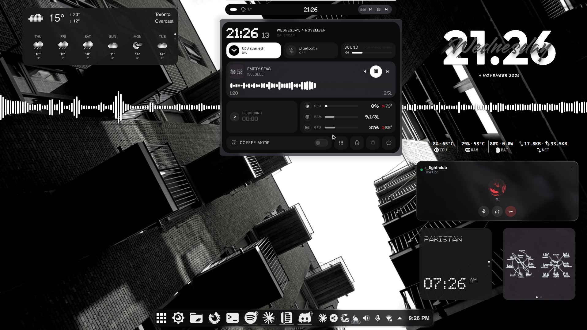
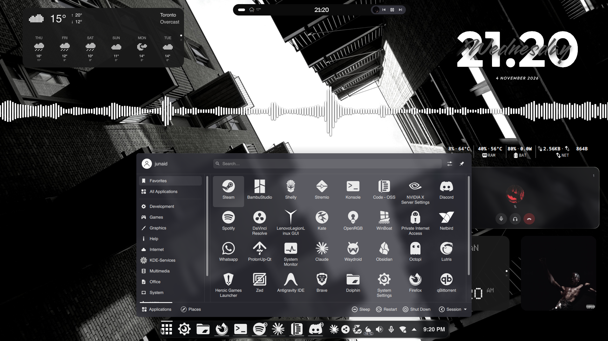
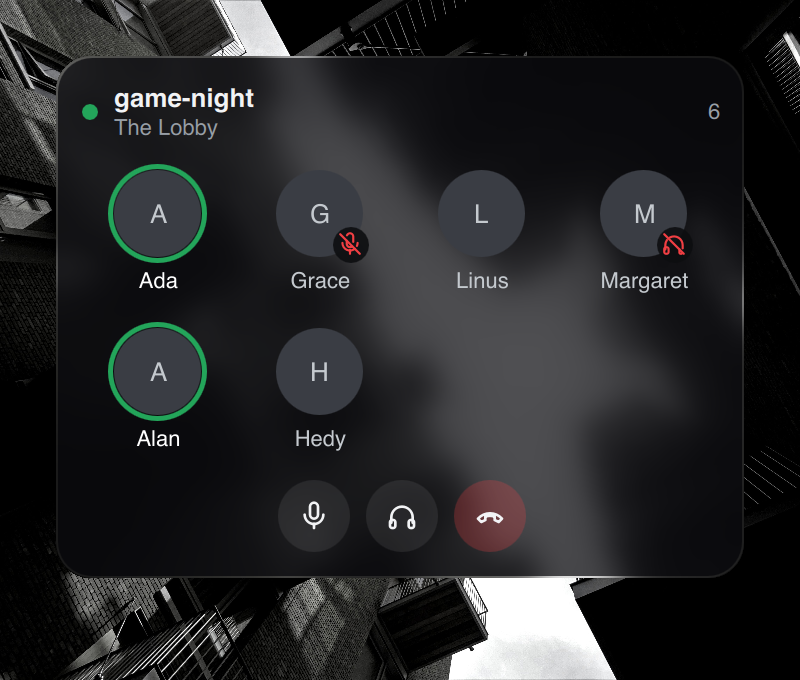
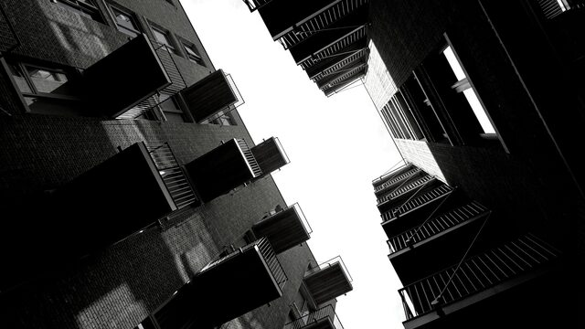
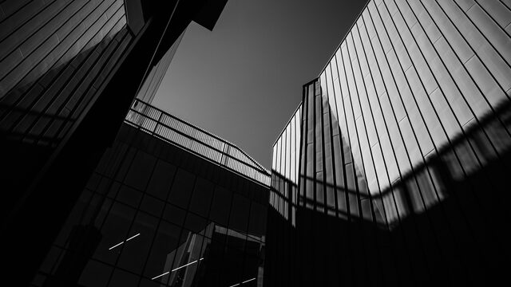

<div align="center">

# cachyos-dotfiles

**A clean, dark CachyOS desktop on KDE Plasma 6, with an installer that asks first and can undo what it changes.**

[](https://cachyos.org/)
[](https://kde.org/plasma-desktop/)
[](https://wayland.freedesktop.org/)
[](https://github.com/junaydirfan/cachyos-dotfiles/actions/workflows/test.yml)
[](LICENSE)

[Screenshots](#screenshots) • [What's included](#whats-included) • [Quick start](#quick-start) • [Pick and choose](#pick-and-choose) • [Discord widget](#discord-voice-widget) • [Help](#help)

</div>

## Screenshots



<sub>The full desktop, with personal details blurred.</sub>



<table>
  <tr>
    <td width="50%" valign="top">
      
    </td>
    <td width="50%" valign="top">
      <strong>Discord voice, on your desktop</strong>
      <br><br>
      See who's in your channel and who's talking without opening Discord. Green rings follow the conversation live, and
      you can mute, deafen, leave or change someone's volume right from the widget.
      <br><br>
      <sub>Shown with sample names.</sub>
    </td>
  </tr>
</table>

**Included wallpapers**

<p>
  
  
  
</p>

## What's included

| | |
| --- | --- |
| **Look** | [Layan](https://github.com/vinceliuice/Layan-kde) theme and window frames, [YAMIS](https://bitbucket.org/dirn-typo/yet-another-monochrome-icon-set) monochrome icons, [WhiteSur](https://github.com/vinceliuice/WhiteSur-cursors) cursors |
| **Dock** | A floating, near-black dock with blur, built with [Panel Colorizer](https://github.com/luisbocanegra/plasma-panel-colorizer) |
| **Control center** | [KDE Control Station](https://github.com/EliverLara/kde-control-station) for Wi-Fi, volume, brightness and media, opened from the dock or with `Meta+Alt+C` |
| **Desktop widgets** | Clock, audio visualizer, system stats, media player and Discord voice |
| **Apps and tools** | fish, Alacritty, Konsole, fastfetch, cava, Zed, micro and Dolphin, all configured |
| **Packages** | Optional groups for desktop, apps, development and gaming, plus GPU and device extras that match your PC |

## Quick start

> [!NOTE]
> You need [CachyOS](https://cachyos.org/) with KDE Plasma. Coming from Windows? Start with [this short guide](docs/coming-from-windows.md).

**1. Download it**

```bash
git clone https://github.com/junaydirfan/cachyos-dotfiles
```

```bash
cd cachyos-dotfiles
```

**2. Preview what would happen.** This changes nothing:

```bash
./install.sh --all --dry-run
```

**3. Run the installer.** The menu asks about each part before doing anything:

```bash
./install.sh
```

**4. Log out and back in** to see every change.

Changed your mind? This puts back what the last run changed:

```bash
./install.sh --undo
```

## Pick and choose

You don't have to take the whole setup. Run only the steps you want:

| Option | What it does |
| --- | --- |
| `--packages` | Installs package groups, asking about each. AUR packages are confirmed one by one. |
| `--themes` | Fetches themes, icons, cursors and widgets from their authors. |
| `--dotfiles` | Copies configs into your home folder, asking about each part. |
| `--only LIST` | Copies just the parts you name, with no prompts. |
| `--plasma` | Applies the panel, widgets, wallpapers and lock screen, then restarts Plasma. |
| `--hardware` | Detects your PC and offers matching GPU packages and device extras. Never part of `--all`. |
| `--all` | Everything except `--hardware`. |
| `--detect` | Shows the CPU, GPUs, monitors and PC type it found, then exits. |
| `--dry-run` | Shows what would happen. |
| `--undo` | Puts back what the most recent run changed. |

Configs come in parts, so you can take just the ones you like:

| Part | Includes |
| --- | --- |
| `shell` | fish |
| `terminal` | Alacritty, Konsole, fastfetch |
| `editors` | Zed, micro |
| `audio` | cava |
| `desktop` | KWin, colors, fonts, Dolphin, GTK apps, mouse cursor, clock format, custom app icons |
| `shortcuts` | Keyboard shortcuts, which replace your own |

For example, to copy only the terminal and shell configs:

```bash
./install.sh --only terminal,shell
```

## Good to know

- **Your files are backed up.** Anything replaced is saved, and `--undo` puts it back. Installed packages stay.
- **Your preferences are respected.** Default apps and display scaling are left alone.
- **One failure won't stop the rest.** You get a list of anything that didn't finish, and running the same command again
  continues from there.
- **Versions are pinned.** Themes and widgets come from fixed versions in `themes/sources.tsv`, so an upstream change
  can't alter what you install.
- **It fits your monitors.** The panel layout adapts to one, two, or three or more screens.
- **A few things aren't included.** Your weather location is yours to set. Helvetica is a commercial font, so you get
  Noto Sans unless you have it.

> [!IMPORTANT]
> Built and used on an Intel and NVIDIA laptop. AMD, Intel-only and desktop PCs are covered by simulated tests, not real
> hardware, and a full clean install hasn't been tried yet. If something breaks, please
> [open an issue](https://github.com/junaydirfan/cachyos-dotfiles/issues) with the output of `./install.sh --detect`.

## Discord voice widget

`--themes` installs the widget. To connect it to Discord, run this and follow the prompts:

```bash
widgets/discord-voice/setup.sh
```

You'll need to create a free Discord app of your own, which takes a few minutes:

1. Open the [Discord developer portal](https://discord.com/developers/applications) and choose **New Application**.
2. Under **OAuth2**, copy the Client ID, then reset to get a Client Secret.
3. Under **OAuth2 > Redirects**, keep one entry, `http://127.0.0.1`, and save.
4. Paste the ID and secret into the setup prompts, then click **Authorize** in Discord.

Then click anyone in the widget to change their volume or mute them for you, or click the channel name to open it in
Discord. Your app's secret stays in `~/.config/discord-voice-widget/config.json` and is never synced.

## Make it yours

Fork the repo, then use the sync script to keep your fork up to date with your own settings.

Capture this PC's settings and push them now:

```bash
scripts/sync-to-github.sh
```

Do that every day:

```bash
scripts/sync-to-github.sh --install
```

Stop the daily sync:

```bash
scripts/sync-to-github.sh --remove
```

A sync scrubs personal data and runs a secret check first. It stops with a notification, and commits nothing, if the
capture fails or removes more than 10 files, the secret check fails, or the repo has uncommitted changes. If GitHub can't
be reached, the next sync pushes the commit. It also warns you if your layout uses a widget the installer can't restore.

To run the secret check on every manual push too:

```bash
git config core.hooksPath .githooks
```

> [!WARNING]
> The check catches known personal values and credential patterns, not everything. On a public repo, read your first
> sync's diff, and add any other private words to `.secrets-local`, one per line.

Custom app icons come along too. Set one on a launcher, or on a panel widget from `~/Pictures`, and the next sync saves it
in `icons/`.

## Help

| Need | Go to |
| --- | --- |
| Something looks wrong | [Troubleshooting](docs/troubleshooting.md) |
| New to Linux | [Coming from Windows](docs/coming-from-windows.md) |
| GPUs, laptops and devices | [Hardware support](hardware/README.md) |
| Sidebar cut off on several monitors | [Add Widgets sidebar fix](hardware/README.md#add-widgets-sidebar) |

## Credits

Themes and widgets belong to their authors and keep their own licenses:

- [Layan](https://github.com/vinceliuice/Layan-kde) and [WhiteSur cursors](https://github.com/vinceliuice/WhiteSur-cursors) by vinceliuice
- [YAMIS](https://bitbucket.org/dirn-typo/yet-another-monochrome-icon-set) by dirn
- [KDE Control Station](https://github.com/EliverLara/kde-control-station) by Eliver Lara, GPLv3. The installer changes one line so it opens on Plasma 6.8
- [ClearClock](https://github.com/qewer33/ClearClock), [KVitals](https://github.com/yassine20011/kvitals),
  [PlasMusic Toolbar](https://github.com/ccatterina/plasmusic-toolbar), [Nothing KDE Widgets](https://github.com/jaxparrow07/nothing-kde-widgets),
  [Panel Colorizer](https://github.com/luisbocanegra/plasma-panel-colorizer) and [Plasma Audio Visualizer](https://github.com/luisbocanegra/plasma-audio-visualizer)
- Wallpapers are photos from [Pexels](https://www.pexels.com/license/) by Sonny and Seven Storm Photography, and aren't covered by this repo's MIT license

My own files are under the [MIT License](LICENSE).
